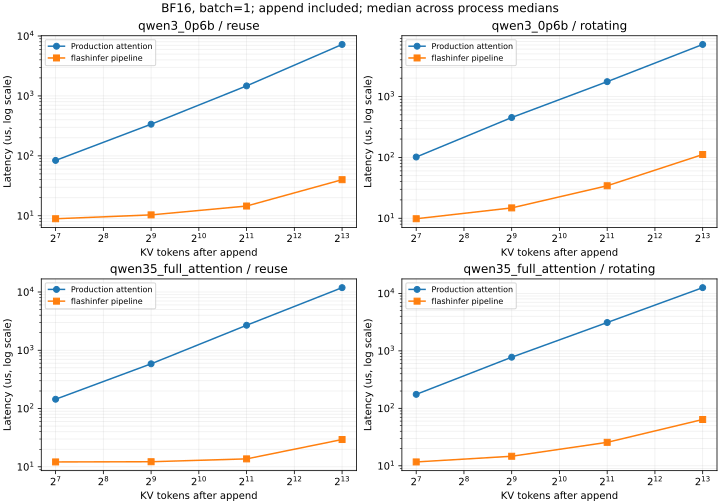
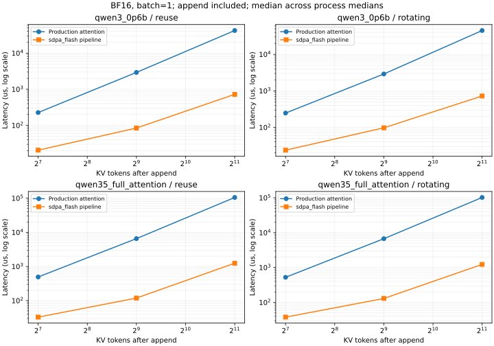

# Attention 性能比较

GPU：NVIDIA GeForce RTX 5060 Ti，SM [12, 0]；PyTorch 2.11.0，CUDA 13.0，FlashInfer 0.7.2.post1，Release。

3 个独立进程，seed=42,43,44；每项每实现 15 组 CUDA event 样本，目标每批 10.0 ms，最多 1024 次调用，预热至少 20 次。

自定义侧统一通过 kernels.hh 调用 src/kernels/cuda/attention.cu；实验目录不包含另一份 CUDA attention 算法。本轮未修改生产算法，不报告内部优化收益。

## 计时与任务边界

- pipeline：追加 KV + paged GQA attention。当前实现为融合调用；FlashInfer 包含 append 与 paged run。
- prefill：同样调用原生产算子，使用 identity 页表。SDPA 对照计入 Torch index_copy_ 的 K/V 追加、相同 cache 零拷贝 dense view 上的 attention，以及写回 NHD 预分配输出的 packing/copy。
- FP32/FP16/BF16、profile、phase、task、缓存条件分别统计，不合并百分比。scale=1/sqrt(D)，dropout=0，不含 RoPE、QK norm、线性投影或 gate。
- Graph + events 测 GPU 执行；不包含分配、输入生成、H2D、plan/JIT、算法选择、正确性与 profiler。实际 backend、workspace、配置校准与误差见 run JSON。
- reuse 复用一组矩阵；rotating 轮换地址，目标 max(64 MiB,2×L2)，最多 32 个 bank，受显存预算限制。未达到目标的项在 CSV 标注，轮换不保证每次访问均为冷缓存。
- replay 固定长度、反复写同一批新 token 槽位，不在重复计时中增长 KV。所有实现使用同一非默认 stream。
- 两个任务均包含 KV append，所有实现都先从干净 cache 验证全量 O、完整 cache 更新及哨兵、重复调用；O 对比禁用 TF32 的 FP32 SDPA-Math，并与独立 FP64 sampled rows 交叉验证。
- FlashInfer 在计时外对 auto/fa2、适用的 SIMT/TC 配置进行独立校准；SDPA 强制单 backend，并记录 profiler 观察到的实际 op。没有把 Math fallback 算成 Flash。
- 进程内取样本中位数，再取进程间中位数；逐 shape 比值等权取几何平均。进程范围不是置信区间，不删除慢样本。

## 分组结果

吞吐比例 = baseline_time / custom_time；100% 表示等速。覆盖率不满时只表示所列共同支持集合。

| 任务 | Profile | 阶段 | dtype | 缓存 | 对照 | 覆盖率 | 吞吐比例 | 进程范围 |
| --- | --- | --- | --- | --- | --- | ---: | ---: | ---: |
| pipeline | qwen35_full_attention | chunked_prefill | bfloat16 | reuse | flashinfer | 8/8 | 1.51% | 1.46–1.51% |
| pipeline | qwen35_full_attention | chunked_prefill | bfloat16 | rotating | flashinfer | 8/8 | 1.46% | 1.43–1.46% |
| pipeline | qwen35_full_attention | chunked_prefill | float16 | reuse | flashinfer | 8/8 | 1.50% | 1.46–1.51% |
| pipeline | qwen35_full_attention | chunked_prefill | float16 | rotating | flashinfer | 8/8 | 1.45% | 1.40–1.46% |
| pipeline | qwen35_full_attention | chunked_prefill | float32 | reuse | flashinfer | 0/8 | — | — |
| pipeline | qwen35_full_attention | chunked_prefill | float32 | rotating | flashinfer | 0/8 | — | — |
| pipeline | qwen35_full_attention | decode | bfloat16 | reuse | flashinfer | 12/12 | 1.84% | 1.81–1.89% |
| pipeline | qwen35_full_attention | decode | bfloat16 | rotating | flashinfer | 12/12 | 2.32% | 2.30–2.33% |
| pipeline | qwen35_full_attention | decode | float16 | reuse | flashinfer | 12/12 | 1.84% | 1.78–1.84% |
| pipeline | qwen35_full_attention | decode | float16 | rotating | flashinfer | 12/12 | 2.33% | 2.32–2.34% |
| pipeline | qwen35_full_attention | decode | float32 | reuse | flashinfer | 0/12 | — | — |
| pipeline | qwen35_full_attention | decode | float32 | rotating | flashinfer | 0/12 | — | — |
| pipeline | qwen35_full_attention | prefill | bfloat16 | reuse | flashinfer | 6/6 | 2.03% | 2.02–2.04% |
| pipeline | qwen35_full_attention | prefill | bfloat16 | rotating | flashinfer | 6/6 | 2.18% | 2.15–2.20% |
| pipeline | qwen35_full_attention | prefill | float16 | reuse | flashinfer | 6/6 | 2.00% | 1.99–2.03% |
| pipeline | qwen35_full_attention | prefill | float16 | rotating | flashinfer | 6/6 | 2.19% | 2.13–2.20% |
| pipeline | qwen35_full_attention | prefill | float32 | reuse | flashinfer | 0/6 | — | — |
| pipeline | qwen35_full_attention | prefill | float32 | rotating | flashinfer | 0/6 | — | — |
| pipeline | qwen35_full_attention | ragged_chunked_prefill | bfloat16 | reuse | flashinfer | 1/1 | 1.22% | 1.16–1.25% |
| pipeline | qwen35_full_attention | ragged_chunked_prefill | bfloat16 | rotating | flashinfer | 1/1 | 1.25% | 1.21–1.25% |
| pipeline | qwen35_full_attention | ragged_chunked_prefill | float16 | reuse | flashinfer | 1/1 | 1.24% | 1.24–1.24% |
| pipeline | qwen35_full_attention | ragged_chunked_prefill | float16 | rotating | flashinfer | 1/1 | 1.23% | 1.22–1.28% |
| pipeline | qwen35_full_attention | ragged_chunked_prefill | float32 | reuse | flashinfer | 0/1 | — | — |
| pipeline | qwen35_full_attention | ragged_chunked_prefill | float32 | rotating | flashinfer | 0/1 | — | — |
| pipeline | qwen35_full_attention | ragged_decode | bfloat16 | reuse | flashinfer | 1/1 | 0.29% | 0.27–0.30% |
| pipeline | qwen35_full_attention | ragged_decode | bfloat16 | rotating | flashinfer | 1/1 | 0.66% | 0.64–0.66% |
| pipeline | qwen35_full_attention | ragged_decode | float16 | reuse | flashinfer | 1/1 | 0.28% | 0.28–0.29% |
| pipeline | qwen35_full_attention | ragged_decode | float16 | rotating | flashinfer | 1/1 | 0.64% | 0.64–0.65% |
| pipeline | qwen35_full_attention | ragged_decode | float32 | reuse | flashinfer | 0/1 | — | — |
| pipeline | qwen35_full_attention | ragged_decode | float32 | rotating | flashinfer | 0/1 | — | — |
| pipeline | qwen3_0p6b | chunked_prefill | bfloat16 | reuse | flashinfer | 8/8 | 2.71% | 2.59–2.75% |
| pipeline | qwen3_0p6b | chunked_prefill | bfloat16 | rotating | flashinfer | 8/8 | 2.83% | 2.80–2.85% |
| pipeline | qwen3_0p6b | chunked_prefill | float16 | reuse | flashinfer | 8/8 | 2.73% | 2.71–2.75% |
| pipeline | qwen3_0p6b | chunked_prefill | float16 | rotating | flashinfer | 8/8 | 2.79% | 2.71–2.87% |
| pipeline | qwen3_0p6b | chunked_prefill | float32 | reuse | flashinfer | 0/8 | — | — |
| pipeline | qwen3_0p6b | chunked_prefill | float32 | rotating | flashinfer | 0/8 | — | — |
| pipeline | qwen3_0p6b | decode | bfloat16 | reuse | flashinfer | 12/12 | 4.35% | 4.25–4.49% |
| pipeline | qwen3_0p6b | decode | bfloat16 | rotating | flashinfer | 12/12 | 6.60% | 6.47–6.67% |
| pipeline | qwen3_0p6b | decode | float16 | reuse | flashinfer | 12/12 | 4.23% | 4.15–4.23% |
| pipeline | qwen3_0p6b | decode | float16 | rotating | flashinfer | 12/12 | 6.53% | 6.50–6.57% |
| pipeline | qwen3_0p6b | decode | float32 | reuse | flashinfer | 0/12 | — | — |
| pipeline | qwen3_0p6b | decode | float32 | rotating | flashinfer | 0/12 | — | — |
| pipeline | qwen3_0p6b | prefill | bfloat16 | reuse | flashinfer | 6/6 | 3.37% | 3.26–3.39% |
| pipeline | qwen3_0p6b | prefill | bfloat16 | rotating | flashinfer | 6/6 | 3.69% | 3.66–3.72% |
| pipeline | qwen3_0p6b | prefill | float16 | reuse | flashinfer | 6/6 | 3.32% | 3.19–3.41% |
| pipeline | qwen3_0p6b | prefill | float16 | rotating | flashinfer | 6/6 | 3.73% | 3.70–3.74% |
| pipeline | qwen3_0p6b | prefill | float32 | reuse | flashinfer | 0/6 | — | — |
| pipeline | qwen3_0p6b | prefill | float32 | rotating | flashinfer | 0/6 | — | — |
| pipeline | qwen3_0p6b | ragged_chunked_prefill | bfloat16 | reuse | flashinfer | 1/1 | 3.13% | 3.04–3.16% |
| pipeline | qwen3_0p6b | ragged_chunked_prefill | bfloat16 | rotating | flashinfer | 1/1 | 2.96% | 2.92–2.99% |
| pipeline | qwen3_0p6b | ragged_chunked_prefill | float16 | reuse | flashinfer | 1/1 | 3.20% | 3.03–3.20% |
| pipeline | qwen3_0p6b | ragged_chunked_prefill | float16 | rotating | flashinfer | 1/1 | 2.96% | 2.89–2.97% |
| pipeline | qwen3_0p6b | ragged_chunked_prefill | float32 | reuse | flashinfer | 0/1 | — | — |
| pipeline | qwen3_0p6b | ragged_chunked_prefill | float32 | rotating | flashinfer | 0/1 | — | — |
| pipeline | qwen3_0p6b | ragged_decode | bfloat16 | reuse | flashinfer | 1/1 | 2.11% | 2.10–2.13% |
| pipeline | qwen3_0p6b | ragged_decode | bfloat16 | rotating | flashinfer | 1/1 | 2.07% | 2.07–2.14% |
| pipeline | qwen3_0p6b | ragged_decode | float16 | reuse | flashinfer | 1/1 | 2.07% | 2.07–2.10% |
| pipeline | qwen3_0p6b | ragged_decode | float16 | rotating | flashinfer | 1/1 | 2.07% | 2.07–2.10% |
| pipeline | qwen3_0p6b | ragged_decode | float32 | reuse | flashinfer | 0/1 | — | — |
| pipeline | qwen3_0p6b | ragged_decode | float32 | rotating | flashinfer | 0/1 | — | — |
| prefill | qwen35_full_attention | prefill | bfloat16 | reuse | flash_attention_optional | 0/6 | — | — |
| prefill | qwen35_full_attention | prefill | bfloat16 | reuse | sdpa_cudnn | 0/6 | — | — |
| prefill | qwen35_full_attention | prefill | bfloat16 | reuse | sdpa_flash | 6/6 | 2.14% | 2.13–2.18% |
| prefill | qwen35_full_attention | prefill | bfloat16 | reuse | sdpa_math | 6/6 | 22.36% | 22.29–22.54% |
| prefill | qwen35_full_attention | prefill | bfloat16 | rotating | flash_attention_optional | 0/6 | — | — |
| prefill | qwen35_full_attention | prefill | bfloat16 | rotating | sdpa_cudnn | 0/6 | — | — |
| prefill | qwen35_full_attention | prefill | bfloat16 | rotating | sdpa_flash | 6/6 | 2.25% | 2.23–2.27% |
| prefill | qwen35_full_attention | prefill | bfloat16 | rotating | sdpa_math | 6/6 | 21.90% | 21.68–21.95% |
| prefill | qwen35_full_attention | prefill | float16 | reuse | flash_attention_optional | 0/6 | — | — |
| prefill | qwen35_full_attention | prefill | float16 | reuse | sdpa_cudnn | 0/6 | — | — |
| prefill | qwen35_full_attention | prefill | float16 | reuse | sdpa_flash | 6/6 | 2.17% | 2.16–2.17% |
| prefill | qwen35_full_attention | prefill | float16 | reuse | sdpa_math | 6/6 | 22.22% | 21.56–22.40% |
| prefill | qwen35_full_attention | prefill | float16 | rotating | flash_attention_optional | 0/6 | — | — |
| prefill | qwen35_full_attention | prefill | float16 | rotating | sdpa_cudnn | 0/6 | — | — |
| prefill | qwen35_full_attention | prefill | float16 | rotating | sdpa_flash | 6/6 | 2.25% | 2.22–2.28% |
| prefill | qwen35_full_attention | prefill | float16 | rotating | sdpa_math | 6/6 | 21.86% | 21.40–22.01% |
| prefill | qwen35_full_attention | prefill | float32 | reuse | flash_attention_optional | 0/6 | — | — |
| prefill | qwen35_full_attention | prefill | float32 | reuse | sdpa_cudnn | 0/6 | — | — |
| prefill | qwen35_full_attention | prefill | float32 | reuse | sdpa_flash | 0/6 | — | — |
| prefill | qwen35_full_attention | prefill | float32 | reuse | sdpa_math | 6/6 | 20.98% | 20.87–20.95% |
| prefill | qwen35_full_attention | prefill | float32 | rotating | flash_attention_optional | 0/6 | — | — |
| prefill | qwen35_full_attention | prefill | float32 | rotating | sdpa_cudnn | 0/6 | — | — |
| prefill | qwen35_full_attention | prefill | float32 | rotating | sdpa_flash | 0/6 | — | — |
| prefill | qwen35_full_attention | prefill | float32 | rotating | sdpa_math | 6/6 | 20.81% | 20.73–21.23% |
| prefill | qwen3_0p6b | prefill | bfloat16 | reuse | flash_attention_optional | 0/6 | — | — |
| prefill | qwen3_0p6b | prefill | bfloat16 | reuse | sdpa_cudnn | 6/6 | 3.11% | 2.96–3.14% |
| prefill | qwen3_0p6b | prefill | bfloat16 | reuse | sdpa_flash | 6/6 | 3.20% | 3.19–3.26% |
| prefill | qwen3_0p6b | prefill | bfloat16 | reuse | sdpa_math | 6/6 | 35.07% | 35.27–35.34% |
| prefill | qwen3_0p6b | prefill | bfloat16 | rotating | flash_attention_optional | 0/6 | — | — |
| prefill | qwen3_0p6b | prefill | bfloat16 | rotating | sdpa_cudnn | 6/6 | 3.38% | 3.31–3.40% |
| prefill | qwen3_0p6b | prefill | bfloat16 | rotating | sdpa_flash | 6/6 | 3.41% | 3.43–3.48% |
| prefill | qwen3_0p6b | prefill | bfloat16 | rotating | sdpa_math | 6/6 | 34.15% | 33.89–34.55% |
| prefill | qwen3_0p6b | prefill | float16 | reuse | flash_attention_optional | 0/6 | — | — |
| prefill | qwen3_0p6b | prefill | float16 | reuse | sdpa_cudnn | 6/6 | 3.12% | 2.92–3.14% |
| prefill | qwen3_0p6b | prefill | float16 | reuse | sdpa_flash | 6/6 | 3.08% | 3.06–3.09% |
| prefill | qwen3_0p6b | prefill | float16 | reuse | sdpa_math | 6/6 | 34.90% | 34.38–35.10% |
| prefill | qwen3_0p6b | prefill | float16 | rotating | flash_attention_optional | 0/6 | — | — |
| prefill | qwen3_0p6b | prefill | float16 | rotating | sdpa_cudnn | 6/6 | 3.40% | 3.36–3.42% |
| prefill | qwen3_0p6b | prefill | float16 | rotating | sdpa_flash | 6/6 | 3.49% | 3.46–3.53% |
| prefill | qwen3_0p6b | prefill | float16 | rotating | sdpa_math | 6/6 | 34.24% | 33.91–34.79% |
| prefill | qwen3_0p6b | prefill | float32 | reuse | flash_attention_optional | 0/6 | — | — |
| prefill | qwen3_0p6b | prefill | float32 | reuse | sdpa_cudnn | 0/6 | — | — |
| prefill | qwen3_0p6b | prefill | float32 | reuse | sdpa_flash | 0/6 | — | — |
| prefill | qwen3_0p6b | prefill | float32 | reuse | sdpa_math | 6/6 | 31.66% | 31.35–31.80% |
| prefill | qwen3_0p6b | prefill | float32 | rotating | flash_attention_optional | 0/6 | — | — |
| prefill | qwen3_0p6b | prefill | float32 | rotating | sdpa_cudnn | 0/6 | — | — |
| prefill | qwen3_0p6b | prefill | float32 | rotating | sdpa_flash | 0/6 | — | — |
| prefill | qwen3_0p6b | prefill | float32 | rotating | sdpa_math | 6/6 | 31.36% | 31.30–31.53% |

## 完整数据与限制

逐项延迟、吞吐比、误差、变异系数、工作集与所有 unavailable 记录见 `summary.csv`、`summary.json` 和 `run-*.json`（归档可为 .json.gz）。进程日志为 `run-*.txt`；版本、命令、GPU 快照和 SHA256 在 `manifest.json`。

基线非成功状态计数（逐 case、逐进程）：{'unsupported': 552, 'not_installed': 216}。284 个有效对照项至少有一端的样本 CV 超过 5%，均保留。

FP64 误差检验使用完整 K 维；长 Q 采样固定行，全量 O 另与 FP32 数学参考比较。所有容差来自 suite.json，没有为保留快结果而放宽。

query tok/s 只表示 attention 算子的输入 query 数 / 时间，不是模型生成速度。本报告没有端到端 prefill/decode 加速结论。

## 简历用语

必须选择一行完整限定的任务/精度/头配置/缓存条件，并注明覆盖的 shape 数，不能把FP32 Math、FP16 Flash 和 paged decode 的结果混在一起。可用模板：

> 实现分页 GQA attention，支持 KV cache 更新与变长 batch；在 RTX 5060 Ti、[dtype、profile、phase、cache、shape 集] 下，吞吐几何平均达到同精度 [FlashInfer append+attention / Torch append+SDPA Flash+NHD输出] 对照的 Y%，并通过输出及 cache 更新一致性验证。

数值 Y 取上表对应分组的吞吐比例。本轮没有修改生产算法，因此不写“相较原始实现降低 X%”。
