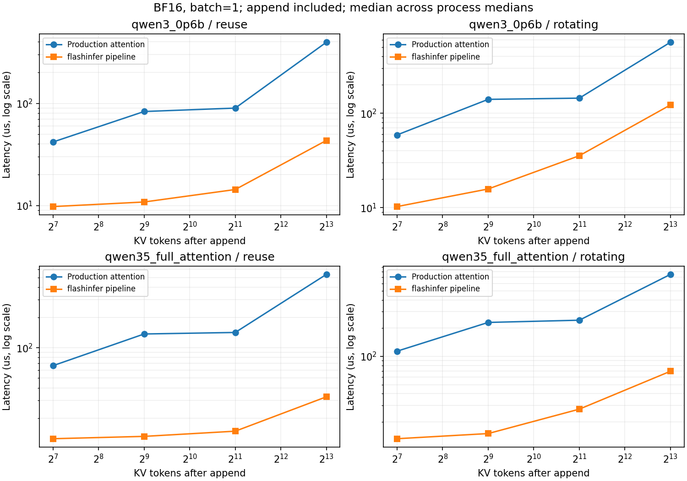
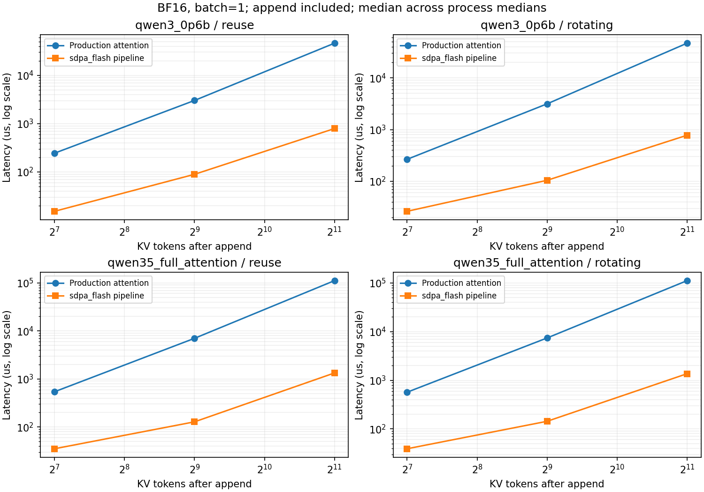

# Split-KV 完整 attention 测试

每进程 408 项，3 个独立进程，共 1224 项；FP32/FP16/BF16、reuse/rotating，包含 pipeline 和连续 prefill。
使用原有 run_attn.py --suite full，无 shape 或 baseline 过滤；每项每实现 15 组样本，seed=42/43/44。
包含 KV 追加，Split-KV 的计算与归并均计时；plan/JIT、分配、校验和 Graph 构建在计时外。

## BF16 / reuse：对照吞吐比例

| 配置 | Decode / FlashInfer（12） | Paged prefill / FlashInfer（6） | 连续 prefill / SDPA Flash（6） |
| --- | ---: | ---: | ---: |
| qwen3_0p6b | 16.31% (12/12) | 3.36% (6/6) | 3.03% (6/6) |
| qwen35_full_attention | 8.47% (12/12) | 2.03% (6/6) | 2.14% (6/6) |

吞吐比例 = baseline_time / project_time × 100%，100% 为等速；各任务、精度和缓存条件分别统计。

## 与上一轮单 block 完整记录对比：BF16 / reuse

| 配置 | 阶段 | shapes | 匹配 shape 的旧/新延迟几何平均 | 对照吞吐比例：旧 → 新 |
| --- | --- | ---: | ---: | ---: |
| qwen3_0p6b | decode | 12 | 1.67× | 9.03% → 16.31% |
| qwen3_0p6b | prefill | 6 | 0.91× | 3.24% → 3.03% |
| qwen35_full_attention | decode | 12 | 1.67× | 4.78% → 8.47% |
| qwen35_full_attention | prefill | 6 | 0.90× | 2.17% → 2.14% |

上一完整记录为 ../rtx5060ti-20261103。这是两次完整测试的对比；频率、系统负载、缓存和 baseline 选择会波动。
同进程交错的 Split-KV 消融见 ../rtx5060ti-20261103-split-kv；两类结果保留各自的口径。Prefill 生产计算路径未改，其变化不归因于 decode 分片。

## 完整结果

[所有精度、阶段、缓存和 baseline 分组](report.md) · [逐项 baseline 延迟 CSV](summary.csv) · [匹配上一完整记录的 CSV](comparison.csv)

## 正确性与完整性

- 全部 1224 个项目侧测量项均通过全量输出、完整 KV cache 更新、哨兵和重复调用检查；容差保持不变。
- FP32 的 FlashInfer 等不支持项保留原状态和原因，不转换精度，也不纳入不匹配的基线均值。
- 运行前后记录的源码与共享库 SHA256 一致，额外核对 API/header/模型调用方；版本与 GPU 快照见 manifest.json，编译参数见 build-info.json。
- 原始 15 组样本、backend 选择、误差、CV、工作集和未支持项完整保存在 run-*.json（归档为 .json.gz）。rotating 不保证全冷缓存。
- 算子时间包含 KV 追加；这些不是模型端到端生成 tok/s。
