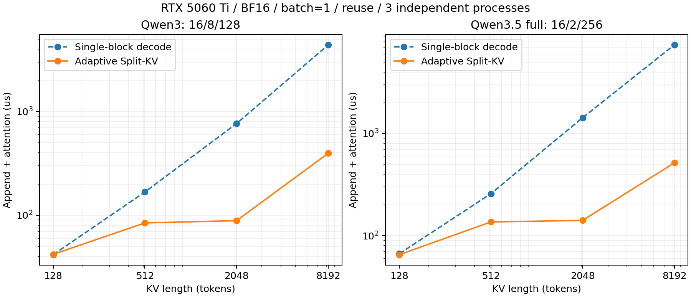

# Split-KV decode：同进程交错对比

3 个独立进程，BF16，每项每实现 15 组 CUDA Graph/event 样本。
两端都包含 KV 追加；新版本的分片计算和归并均计时。预分配、正确性验证、Graph 构建不计时。
每项先取样本中位数，再取进程中位数；逐 shape 的旧/新延迟等权取几何平均。

| 配置 | 缓存 | decode shapes | 相较单 block 版本 |
| --- | --- | ---: | ---: |
| qwen3_0p6b | reuse | 12 | 1.86× |
| qwen3_0p6b | rotating | 12 | 1.74× |
| qwen35_full_attention | reuse | 12 | 1.94× |
| qwen35_full_attention | rotating | 12 | 1.82× |

## BF16 / reuse / B=1 / KV=8192

| 配置 | 单 block | Split-KV | 加速 |
| --- | ---: | ---: | ---: |
| qwen35_full_attention | 7366.02 μs | 516.75 μs | 14.25× |
| qwen3_0p6b | 4400.81 μs | 396.50 μs | 11.10× |

完整 shape 延迟见 summary.csv；原始样本、每组执行顺序、误差、工作集与工作区大小见 run-*.json。
rotating 为地址轮换，未达到目标工作集的项保留标记，不保证全冷缓存。
这是 BF16 decode 算子消融，不包含 FlashInfer 重测或端到端生成性能。

## 实现与验证

- 分片最多 32 份，目标约 256 个 block，按每片平均至少 256 个 token 限制；短序列和已有足够 block 的 batch 使用单阶段。
- 每片存 FP32 未归一化输出及 softmax 最大值/分母；归并按最大值重新缩放，支持变长请求、空分片和 GQA。新 KV 从输入读取，只有所属分片及 KV head 的首个 query head 写入 cache。
- 工作区由调用方在 capture 外分配；引擎在初始化时分配并由同 stream 的各层复用。算子内不分配显存，不做全局同步。
- 212 个既有数值边界检查、11 项测试（含多组 GPU 子用例、32 分片、空分片、极端分数、双 stream Graph 重放）通过。132 个原生用例分别通过 memcheck/racecheck，0 errors/0 hazards。
- 三轮共 156 个 shape/cache 比较项，两端均通过输出和完整 cache 更新检查；最大容差比 0.0354，阈值 1。
- 未分片路径的逐项时间存在几个百分点的测量变化，完整样本和 CV 保留。Prefill kernel 函数体未改，本次未重复完整 prefill 性能测试。
- 编译命令、前后源文件及共享库 SHA256 见 [build-info.json](build-info.json)，测试和访存检查见 [validation.json](validation.json)、[unit-tests.txt](unit-tests.txt)。计时前后全部记录的源码与两份共享库均保持一致，并与最终交付版本核对。
- 可在仓库根目录用 `exp/attn/bench_split_kv.py` 重测；具体命令记录在 build-info.json，需保留或重建对应的修改前共享库。
