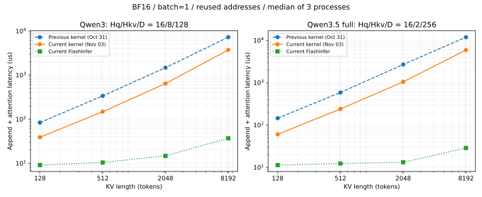

# Attention kernel 复测：2026-11-03 对比 2026-10-31

当前版本：`159e84a09efb03f7d9821a58fb4023b753e9413d`；RTX 5060 Ti，Release / -O3 / SM120。
本次使用加入 decode 专用分支的生产 kernel，测试脚本与上次相同；仅 attention.cu 的源码 hash 变化。

3 个独立进程，seed=42/43/44；每进程 408 项，共 1224 项。每项每实现 15 组样本，至少预热 20 次，目标每组 10 ms，最多 1024 次调用。
每项先取样本中位数，再取三进程中位数；跨 shape 对旧延迟/新延迟等权取几何平均。
所有计时包含 KV 追加；pipeline 对比 FlashInfer append+attention，连续 prefill 对比 Torch append+SDPA+NHD 输出写回。两类任务分别统计。

## BF16 / reuse 主结果

| 配置 | 阶段 / 对照 | shapes | 相较旧 kernel | 旧吞吐达到对照 | 新吞吐达到对照 |
| --- | --- | ---: | ---: | ---: | ---: |
| qwen3_0p6b | decode / flashinfer | 12 | 2.13× | 4.35% | 9.03% |
| qwen3_0p6b | prefill / sdpa_flash | 6 | 1.03× | 3.20% | 3.24% |
| qwen35_full_attention | decode / flashinfer | 12 | 2.69× | 1.84% | 4.78% |
| qwen35_full_attention | prefill / sdpa_flash | 6 | 1.04× | 2.14% | 2.17% |

100% 表示与对照等速。旧、新吞吐比例分别使用各次重测的 baseline；“相较旧 kernel”直接由匹配 shape 的生产 kernel 延迟计算，避免将 baseline 波动当成 kernel 加速。



## 长上下文 decode：BF16 / reuse / batch=1 / KV=8192

| 配置 | 旧 kernel | 新 kernel | 加速 | 当前 FlashInfer |
| --- | ---: | ---: | ---: | ---: |
| qwen3_0p6b | 7.230 ms | 3.719 ms | 1.94× | 36.97 μs |
| qwen35_full_attention | 11.877 ms | 5.897 ms | 2.01× | 28.57 μs |

## 正确性与可比性

- 212 个边界检查通过；正式采样的 1224 项均通过输出与完整 cache 更新检查。最大容差比 0.0968（阈值 1）。
- 原生 36 个代表用例分别通过 memcheck 和 racecheck，0 errors / 0 hazards。
- 运行前后源码及共享库 SHA256 一致；版本、命令、GPU 快照见 manifest.json，编译参数见 build-info.json。
- 与旧记录的硬件元数据一致：True；软件版本一致：True。
- 这是跨日期的实测对比。GPU 频率、系统负载和缓存会造成波动；prefill/chunked prefill 的计算路径没有代码修改，其延迟变化不能归因于 decode 优化。
- rotating 是地址轮换，受最多 32 个 bank 和显存预算限制，不等于每次访问全冷缓存；逐项工作集和 CV 均保留。
- FP32 在本环境 FlashInfer 中不支持，保留 unsupported；不转换精度。query tok/s 仅为算子指标，不是模型生成速度。
- 原 runner 的 contract.production_optimized=false 是历史常量；本次实际运行版本以本报告、源码 hash 和 commit 为准。

## 全部分组：旧 kernel / 新 kernel

| 任务 | 配置 | 阶段 | 精度 | 缓存 | shapes | 加速 | 逐 shape 范围 |
| --- | --- | --- | --- | --- | ---: | ---: | ---: |
| pipeline | qwen35_full_attention | chunked_prefill | bfloat16 | reuse | 8 | 1.036× | 1.000–1.067× |
| pipeline | qwen35_full_attention | chunked_prefill | bfloat16 | rotating | 8 | 1.027× | 1.016–1.046× |
| pipeline | qwen35_full_attention | chunked_prefill | float16 | reuse | 8 | 1.033× | 0.996–1.074× |
| pipeline | qwen35_full_attention | chunked_prefill | float16 | rotating | 8 | 1.031× | 1.012–1.080× |
| pipeline | qwen35_full_attention | chunked_prefill | float32 | reuse | 8 | 1.027× | 0.998–1.052× |
| pipeline | qwen35_full_attention | chunked_prefill | float32 | rotating | 8 | 1.037× | 1.017–1.078× |
| pipeline | qwen35_full_attention | decode | bfloat16 | reuse | 12 | 2.692× | 1.938–4.492× |
| pipeline | qwen35_full_attention | decode | bfloat16 | rotating | 12 | 2.156× | 1.787–2.949× |
| pipeline | qwen35_full_attention | decode | float16 | reuse | 12 | 2.641× | 1.898–4.145× |
| pipeline | qwen35_full_attention | decode | float16 | rotating | 12 | 2.176× | 1.782–2.990× |
| pipeline | qwen35_full_attention | decode | float32 | reuse | 12 | 2.575× | 1.840–3.816× |
| pipeline | qwen35_full_attention | decode | float32 | rotating | 12 | 2.183× | 1.809–2.977× |
| pipeline | qwen35_full_attention | prefill | bfloat16 | reuse | 6 | 1.035× | 0.968–1.070× |
| pipeline | qwen35_full_attention | prefill | bfloat16 | rotating | 6 | 1.035× | 1.005–1.058× |
| pipeline | qwen35_full_attention | prefill | float16 | reuse | 6 | 1.049× | 1.018–1.080× |
| pipeline | qwen35_full_attention | prefill | float16 | rotating | 6 | 1.031× | 1.022–1.043× |
| pipeline | qwen35_full_attention | prefill | float32 | reuse | 6 | 1.023× | 1.003–1.071× |
| pipeline | qwen35_full_attention | prefill | float32 | rotating | 6 | 1.026× | 1.014–1.052× |
| pipeline | qwen35_full_attention | ragged_chunked_prefill | bfloat16 | reuse | 1 | 1.045× | 1.045–1.045× |
| pipeline | qwen35_full_attention | ragged_chunked_prefill | bfloat16 | rotating | 1 | 1.018× | 1.018–1.018× |
| pipeline | qwen35_full_attention | ragged_chunked_prefill | float16 | reuse | 1 | 1.037× | 1.037–1.037× |
| pipeline | qwen35_full_attention | ragged_chunked_prefill | float16 | rotating | 1 | 1.066× | 1.066–1.066× |
| pipeline | qwen35_full_attention | ragged_chunked_prefill | float32 | reuse | 1 | 1.026× | 1.026–1.026× |
| pipeline | qwen35_full_attention | ragged_chunked_prefill | float32 | rotating | 1 | 1.051× | 1.051–1.051× |
| pipeline | qwen35_full_attention | ragged_decode | bfloat16 | reuse | 1 | 2.081× | 2.081–2.081× |
| pipeline | qwen35_full_attention | ragged_decode | bfloat16 | rotating | 1 | 1.848× | 1.848–1.848× |
| pipeline | qwen35_full_attention | ragged_decode | float16 | reuse | 1 | 2.161× | 2.161–2.161× |
| pipeline | qwen35_full_attention | ragged_decode | float16 | rotating | 1 | 1.888× | 1.888–1.888× |
| pipeline | qwen35_full_attention | ragged_decode | float32 | reuse | 1 | 1.876× | 1.876–1.876× |
| pipeline | qwen35_full_attention | ragged_decode | float32 | rotating | 1 | 1.869× | 1.869–1.869× |
| pipeline | qwen3_0p6b | chunked_prefill | bfloat16 | reuse | 8 | 1.030× | 1.000–1.068× |
| pipeline | qwen3_0p6b | chunked_prefill | bfloat16 | rotating | 8 | 1.038× | 1.006–1.088× |
| pipeline | qwen3_0p6b | chunked_prefill | float16 | reuse | 8 | 1.011× | 0.982–1.040× |
| pipeline | qwen3_0p6b | chunked_prefill | float16 | rotating | 8 | 1.041× | 1.001–1.073× |
| pipeline | qwen3_0p6b | chunked_prefill | float32 | reuse | 8 | 1.030× | 1.003–1.074× |
| pipeline | qwen3_0p6b | chunked_prefill | float32 | rotating | 8 | 1.037× | 1.015–1.074× |
| pipeline | qwen3_0p6b | decode | bfloat16 | reuse | 12 | 2.130× | 1.777–2.406× |
| pipeline | qwen3_0p6b | decode | bfloat16 | rotating | 12 | 1.855× | 1.723–2.180× |
| pipeline | qwen3_0p6b | decode | float16 | reuse | 12 | 2.142× | 1.789–2.398× |
| pipeline | qwen3_0p6b | decode | float16 | rotating | 12 | 1.874× | 1.757–2.166× |
| pipeline | qwen3_0p6b | decode | float32 | reuse | 12 | 2.085× | 1.818–2.419× |
| pipeline | qwen3_0p6b | decode | float32 | rotating | 12 | 1.815× | 1.717–1.873× |
| pipeline | qwen3_0p6b | prefill | bfloat16 | reuse | 6 | 1.021× | 0.994–1.052× |
| pipeline | qwen3_0p6b | prefill | bfloat16 | rotating | 6 | 1.030× | 1.001–1.065× |
| pipeline | qwen3_0p6b | prefill | float16 | reuse | 6 | 1.046× | 1.024–1.068× |
| pipeline | qwen3_0p6b | prefill | float16 | rotating | 6 | 1.034× | 1.005–1.074× |
| pipeline | qwen3_0p6b | prefill | float32 | reuse | 6 | 1.034× | 1.014–1.064× |
| pipeline | qwen3_0p6b | prefill | float32 | rotating | 6 | 1.035× | 1.010–1.073× |
| pipeline | qwen3_0p6b | ragged_chunked_prefill | bfloat16 | reuse | 1 | 1.009× | 1.009–1.009× |
| pipeline | qwen3_0p6b | ragged_chunked_prefill | bfloat16 | rotating | 1 | 1.028× | 1.028–1.028× |
| pipeline | qwen3_0p6b | ragged_chunked_prefill | float16 | reuse | 1 | 0.997× | 0.997–0.997× |
| pipeline | qwen3_0p6b | ragged_chunked_prefill | float16 | rotating | 1 | 1.021× | 1.021–1.021× |
| pipeline | qwen3_0p6b | ragged_chunked_prefill | float32 | reuse | 1 | 1.020× | 1.020–1.020× |
| pipeline | qwen3_0p6b | ragged_chunked_prefill | float32 | rotating | 1 | 1.020× | 1.020–1.020× |
| pipeline | qwen3_0p6b | ragged_decode | bfloat16 | reuse | 1 | 1.821× | 1.821–1.821× |
| pipeline | qwen3_0p6b | ragged_decode | bfloat16 | rotating | 1 | 1.892× | 1.892–1.892× |
| pipeline | qwen3_0p6b | ragged_decode | float16 | reuse | 1 | 1.865× | 1.865–1.865× |
| pipeline | qwen3_0p6b | ragged_decode | float16 | rotating | 1 | 1.836× | 1.836–1.836× |
| pipeline | qwen3_0p6b | ragged_decode | float32 | reuse | 1 | 1.871× | 1.871–1.871× |
| pipeline | qwen3_0p6b | ragged_decode | float32 | rotating | 1 | 1.858× | 1.858–1.858× |
| prefill | qwen35_full_attention | prefill | bfloat16 | reuse | 6 | 1.037× | 1.002–1.063× |
| prefill | qwen35_full_attention | prefill | bfloat16 | rotating | 6 | 1.023× | 1.015–1.034× |
| prefill | qwen35_full_attention | prefill | float16 | reuse | 6 | 1.022× | 0.998–1.040× |
| prefill | qwen35_full_attention | prefill | float16 | rotating | 6 | 1.048× | 1.024–1.083× |
| prefill | qwen35_full_attention | prefill | float32 | reuse | 6 | 1.031× | 1.014–1.053× |
| prefill | qwen35_full_attention | prefill | float32 | rotating | 6 | 1.032× | 1.020–1.060× |
| prefill | qwen3_0p6b | prefill | bfloat16 | reuse | 6 | 1.029× | 0.980–1.073× |
| prefill | qwen3_0p6b | prefill | bfloat16 | rotating | 6 | 1.041× | 1.016–1.080× |
| prefill | qwen3_0p6b | prefill | float16 | reuse | 6 | 1.028× | 1.012–1.054× |
| prefill | qwen3_0p6b | prefill | float16 | rotating | 6 | 1.027× | 1.010–1.056× |
| prefill | qwen3_0p6b | prefill | float32 | reuse | 6 | 1.042× | 1.014–1.091× |
| prefill | qwen3_0p6b | prefill | float32 | rotating | 6 | 1.029× | 1.003–1.053× |

## 产物

- [本轮 baseline 分组报告](report.md)、[全部 baseline 逐项 CSV](summary.csv)。
- [匹配旧版的逐项 CSV](comparison.csv)、[比较 JSON](comparison.json)。
- [正确性与完整性验证](validation.json)、[212 个边界检查](correctness.json)。
- run-*.json（归档为 .json.gz）保留全部原始样本、baseline 选择、误差及不支持原因。
- compare_previous.py 是本比较的可复现汇总脚本；旧结果位于 ../rtx5060ti-20261031。

在仓库根目录重新生成归档报告：

```bash
build/attn-venv/bin/python exp/attn/run_attn.py --report-only exp/attn/results/rtx5060ti-20261103
build/attn-venv/bin/python exp/attn/results/rtx5060ti-20261103/compare_previous.py exp/attn/results/rtx5060ti-20261031 exp/attn/results/rtx5060ti-20261103
```
