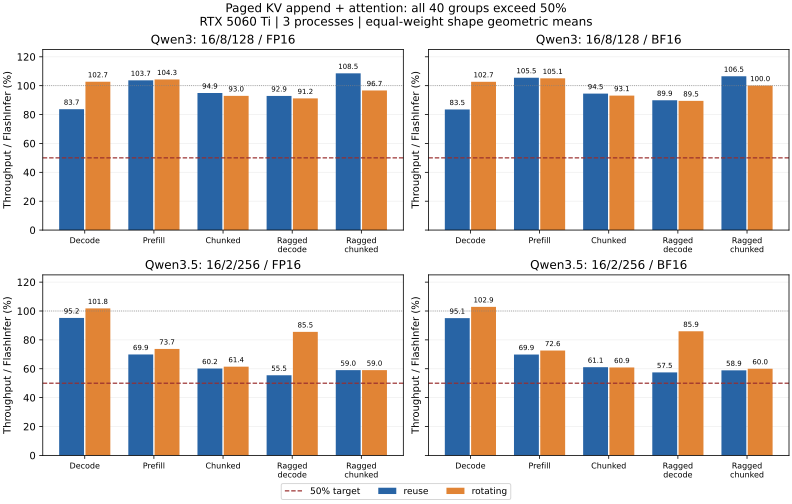

# FlashInfer 50% 目标验收

2026-11-04，RTX 5060 Ti / SM120，CUDA 编译器 13.3.73，PyTorch 2.11.0 + CUDA 13.0，
FlashInfer 0.7.2.post1，Release / `-O3`。

按仓库既有的**等权 shape 几何平均**口径，全部 **40 个分组达到 50%**，
最低 **55.49%**，最高 **108.55%**。分组为 2 个模型头配置 × 5 个阶段 ×
FP16/BF16 × reuse/rotating；没有合并精度、缓存条件或丢弃变长请求。



## 同一项工作的比较

项目侧调用生产 `flash_attn_with_kvcache()`；对照为同精度 FlashInfer
`append_paged_kv_cache + paged attention run`。两端均包含 KV 追加，使用相同的
随机物理页、NHD cache、GQA、scale、右下 causal mask 和输出布局。
没有将 FlashInfer 纳入项目实现，也没有用只读 attention 替代生产算子。

完整使用 `suite.json` 中 56 个分页 shape，包含 decode、prefill、chunked prefill、
ragged decode 和 ragged chunked prefill。每个进程 56 × 2 精度 × 2 缓存条件
= **224 项**，三个独立进程共 **672 项**，seed=42/43/44。
每项每实现预热至少 20 次，采样 15 组，Graph 每组目标 10 ms，最多 1024 次调用。
两端随机交错；规划、JIT、正确性和分配在计时外，workspace、归并和 append 的 GPU
执行计入计时。全部 FlashInfer 候选与选择过程保留在原始数据中。

每进程取样本中位数，再取三个进程的中位数。逐 shape 比例为
`FlashInfer_us / production_us`，再在每个分组内等权取几何平均。
100% 表示等速，50% 对应项目延迟为 FlashInfer 的两倍。

## BF16 / reuse

| 配置 Hq/Hkv/D | Decode（12） | Prefill（6） | Chunked（8） | Ragged decode（1） | Ragged chunked（1） |
| --- | ---: | ---: | ---: | ---: | ---: |
| Qwen3：16/8/128 | 83.52% | 105.51% | 94.50% | 89.88% | 106.52% |
| Qwen3.5 full attention：16/2/256 | 95.06% | 69.86% | 61.07% | 57.46% | 58.91% |

[完整 40 组及进程范围](report.md) · [全部 224 项 CSV](summary.csv) ·
[机器可读验收](target-check.json)。进程范围不是置信区间，原始慢样本全部保留。

## 具体实现与验证

FP16/BF16 的 D=128/256 使用 `mma.sync`、FP32 softmax/输出累加、`ldmatrix`
和 `cp.async`。同组 query head 共享 KV；D=256 decode 的 warp 分摊输出维度，
D=128 decode 使用向量化 SIMT。按长度、有效 packed token 数和并行度选择 KV 分片，
FP32 scratch 保存局部最大值、分母及未归一化输出，再稳定归并。
工作区由引擎预分配并经 `ForwardContext` 传入，不在算子内分配或全局同步。

最终源码与共享库在三进程测量前后 SHA256 一致；逐进程哈希也一致。
全部项目/FlashInfer 输出分别通过 FP32 Math 与 FP64 参考校验，并检查完整 cache
更新、旧 prefix、未用页、页尾 padding、输出哨兵和重复调用。

- [212 项边界检查](correctness.json)，覆盖 FP32/FP16/BF16。
- [15 个测试方法](unit-tests.txt)，包含大量页大小、GQA、分片、空请求/空分片、
  极端分数、scratch poison 和双 stream Graph 重放子用例。
- [168 项原生 memcheck](memcheck.txt)：0 errors。
- [168 项原生 racecheck](racecheck.txt)：0 errors / 0 warnings。
- 生产静态库及原生检查程序构建通过；SM75 编译检查通过，运行时保留 SIMT fallback。
  [编译命令](build-info.json)与[测量命令、环境、哈希](manifest.json)均已归档。

使用当前构建和源码复核全部样本、中位数、覆盖率、哈希及 40 组门槛：

```bash
python3 exp/attn/results/rtx5060ti-20261104-tensor-core/verify_results.py
build/attn-venv/bin/python exp/attn/run_attn.py \
  --report-only exp/attn/results/rtx5060ti-20261104-tensor-core
```

原始 `run-001/002/003.json.gz` 为无损压缩归档；验收脚本同时支持未压缩 JSON。

## 限制与未达标单项

**分组达标不等于每个单项都超过 50%。** 219/224 项超过门槛，以下 5 项保留：

| Qwen3.5，D=256，Q=16，prefix=2048 | 比例 |
| --- | ---: |
| B=1，BF16，reuse | 48.43% |
| B=1，BF16，rotating | 47.30% |
| B=1，FP16，reuse | 46.76% |
| B=1，FP16，rotating | 48.10% |
| B=4，BF16，reuse | 49.33% |

本次结论只覆盖所列 GPU、软件版本和 FP16/BF16 分页算子，**不代表每个 GPU、每个
shape 或模型端到端速度**。FP32 继续执行同精度 SIMT，不偷偷转成半精度；当前
FlashInfer 的 FP32 对应项不支持，未混入 50% 指标。地址轮换不保证每次访问全冷缓存，
是否达到目标工作集见逐项 CSV；不同进程与显示负载的波动见原始样本和报告。
