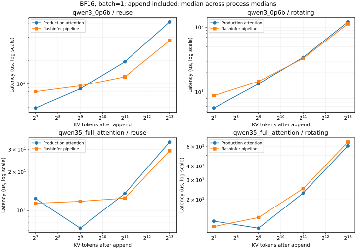

# Attention 性能比较

GPU：NVIDIA GeForce RTX 5060 Ti，SM [12, 0]；PyTorch 2.11.0，CUDA 13.0，FlashInfer 0.7.2.post1，Release。

3 个独立进程，seed=42,43,44；每项每实现 15 组 CUDA event 样本，目标每批 10.0 ms，最多 1024 次调用，预热至少 20 次。

自定义侧统一通过 kernels.hh 调用 src/kernels/cuda/attention.cu；实验目录不包含另一份 CUDA attention 算法。具体 kernel 版本由 manifest 中的源码与共享库 SHA256 标识；历史版本的内部加速需另做匹配对比。

## 计时与任务边界

- pipeline：追加 KV + paged GQA attention。当前实现为融合调用；FlashInfer 包含 append 与 paged run。
- prefill：同样调用原生产算子，使用 identity 页表。SDPA 对照计入 Torch index_copy_ 的 K/V 追加、相同 cache 零拷贝 dense view 上的 attention，以及写回 NHD 预分配输出的 packing/copy。
- FP32/FP16/BF16、profile、phase、task、缓存条件分别统计，不合并百分比。scale=1/sqrt(D)，dropout=0，不含 RoPE、QK norm、线性投影或 gate。
- Graph + events 测 GPU 执行；不包含分配、输入生成、H2D、plan/JIT、算法选择、正确性与 profiler。实际 backend、workspace、配置校准与误差见 run JSON。
- reuse 复用一组矩阵；rotating 轮换地址，目标 max(64 MiB,2×L2)，最多 32 个 bank，受显存预算限制。未达到目标的项在 CSV 标注，轮换不保证每次访问均为冷缓存。
- replay 固定长度、反复写同一批新 token 槽位，不在重复计时中增长 KV。所有实现使用同一非默认 stream。
- 两个任务均包含 KV append，所有实现都先从干净 cache 验证全量 O、完整 cache 更新及哨兵、重复调用；O 对比禁用 TF32 的 FP32 SDPA-Math，并与独立 FP64 sampled rows 交叉验证。
- FlashInfer 在计时外对 auto/fa2、适用的 SIMT/TC 配置进行独立校准；SDPA 强制单 backend，并记录 profiler 观察到的实际 op。没有把 Math fallback 算成 Flash。
- 进程内取样本中位数，再取进程间中位数；逐 shape 比值等权取几何平均。进程范围不是置信区间，不删除慢样本。

## 分组结果

吞吐比例 = baseline_time / custom_time；100% 表示等速。覆盖率不满时只表示所列共同支持集合。

| 任务 | Profile | 阶段 | dtype | 缓存 | 对照 | 覆盖率 | 吞吐比例 | 进程范围 |
| --- | --- | --- | --- | --- | --- | ---: | ---: | ---: |
| pipeline | qwen35_full_attention | chunked_prefill | bfloat16 | reuse | flashinfer | 8/8 | 61.07% | 60.30–61.69% |
| pipeline | qwen35_full_attention | chunked_prefill | bfloat16 | rotating | flashinfer | 8/8 | 60.87% | 60.47–60.98% |
| pipeline | qwen35_full_attention | chunked_prefill | float16 | reuse | flashinfer | 8/8 | 60.15% | 59.44–60.60% |
| pipeline | qwen35_full_attention | chunked_prefill | float16 | rotating | flashinfer | 8/8 | 61.44% | 61.14–61.81% |
| pipeline | qwen35_full_attention | decode | bfloat16 | reuse | flashinfer | 12/12 | 95.06% | 93.00–96.76% |
| pipeline | qwen35_full_attention | decode | bfloat16 | rotating | flashinfer | 12/12 | 102.85% | 102.19–104.49% |
| pipeline | qwen35_full_attention | decode | float16 | reuse | flashinfer | 12/12 | 95.19% | 95.07–96.82% |
| pipeline | qwen35_full_attention | decode | float16 | rotating | flashinfer | 12/12 | 101.79% | 101.33–102.96% |
| pipeline | qwen35_full_attention | prefill | bfloat16 | reuse | flashinfer | 6/6 | 69.86% | 67.91–70.71% |
| pipeline | qwen35_full_attention | prefill | bfloat16 | rotating | flashinfer | 6/6 | 72.61% | 72.48–73.29% |
| pipeline | qwen35_full_attention | prefill | float16 | reuse | flashinfer | 6/6 | 69.88% | 65.61–70.70% |
| pipeline | qwen35_full_attention | prefill | float16 | rotating | flashinfer | 6/6 | 73.71% | 72.99–73.97% |
| pipeline | qwen35_full_attention | ragged_chunked_prefill | bfloat16 | reuse | flashinfer | 1/1 | 58.91% | 46.50–59.41% |
| pipeline | qwen35_full_attention | ragged_chunked_prefill | bfloat16 | rotating | flashinfer | 1/1 | 60.02% | 59.03–61.52% |
| pipeline | qwen35_full_attention | ragged_chunked_prefill | float16 | reuse | flashinfer | 1/1 | 59.04% | 58.63–60.37% |
| pipeline | qwen35_full_attention | ragged_chunked_prefill | float16 | rotating | flashinfer | 1/1 | 59.05% | 59.05–60.32% |
| pipeline | qwen35_full_attention | ragged_decode | bfloat16 | reuse | flashinfer | 1/1 | 57.46% | 55.56–59.48% |
| pipeline | qwen35_full_attention | ragged_decode | bfloat16 | rotating | flashinfer | 1/1 | 85.94% | 85.47–86.81% |
| pipeline | qwen35_full_attention | ragged_decode | float16 | reuse | flashinfer | 1/1 | 55.49% | 55.04–57.17% |
| pipeline | qwen35_full_attention | ragged_decode | float16 | rotating | flashinfer | 1/1 | 85.52% | 85.44–85.70% |
| pipeline | qwen3_0p6b | chunked_prefill | bfloat16 | reuse | flashinfer | 8/8 | 94.50% | 93.50–94.25% |
| pipeline | qwen3_0p6b | chunked_prefill | bfloat16 | rotating | flashinfer | 8/8 | 93.11% | 91.81–93.13% |
| pipeline | qwen3_0p6b | chunked_prefill | float16 | reuse | flashinfer | 8/8 | 94.93% | 93.48–94.17% |
| pipeline | qwen3_0p6b | chunked_prefill | float16 | rotating | flashinfer | 8/8 | 92.96% | 92.48–94.39% |
| pipeline | qwen3_0p6b | decode | bfloat16 | reuse | flashinfer | 12/12 | 83.52% | 82.07–84.40% |
| pipeline | qwen3_0p6b | decode | bfloat16 | rotating | flashinfer | 12/12 | 102.69% | 102.51–104.65% |
| pipeline | qwen3_0p6b | decode | float16 | reuse | flashinfer | 12/12 | 83.72% | 83.35–86.34% |
| pipeline | qwen3_0p6b | decode | float16 | rotating | flashinfer | 12/12 | 102.71% | 102.46–105.11% |
| pipeline | qwen3_0p6b | prefill | bfloat16 | reuse | flashinfer | 6/6 | 105.51% | 103.41–106.91% |
| pipeline | qwen3_0p6b | prefill | bfloat16 | rotating | flashinfer | 6/6 | 105.06% | 101.70–105.83% |
| pipeline | qwen3_0p6b | prefill | float16 | reuse | flashinfer | 6/6 | 103.69% | 103.93–104.41% |
| pipeline | qwen3_0p6b | prefill | float16 | rotating | flashinfer | 6/6 | 104.30% | 103.59–104.70% |
| pipeline | qwen3_0p6b | ragged_chunked_prefill | bfloat16 | reuse | flashinfer | 1/1 | 106.52% | 102.85–106.52% |
| pipeline | qwen3_0p6b | ragged_chunked_prefill | bfloat16 | rotating | flashinfer | 1/1 | 100.04% | 98.33–100.04% |
| pipeline | qwen3_0p6b | ragged_chunked_prefill | float16 | reuse | flashinfer | 1/1 | 108.55% | 105.82–112.65% |
| pipeline | qwen3_0p6b | ragged_chunked_prefill | float16 | rotating | flashinfer | 1/1 | 96.66% | 95.31–99.52% |
| pipeline | qwen3_0p6b | ragged_decode | bfloat16 | reuse | flashinfer | 1/1 | 89.88% | 88.72–90.94% |
| pipeline | qwen3_0p6b | ragged_decode | bfloat16 | rotating | flashinfer | 1/1 | 89.47% | 89.33–92.89% |
| pipeline | qwen3_0p6b | ragged_decode | float16 | reuse | flashinfer | 1/1 | 92.89% | 89.59–94.06% |
| pipeline | qwen3_0p6b | ragged_decode | float16 | rotating | flashinfer | 1/1 | 91.18% | 86.91–94.94% |

## 完整数据与限制

逐项延迟、吞吐比、误差、变异系数、工作集与所有 unavailable 记录见 `summary.csv`、`summary.json` 和 `run-*.json`（归档可为 .json.gz）。进程日志为 `run-*.txt`；版本、命令、GPU 快照和 SHA256 在 `manifest.json`。

基线非成功状态计数（逐 case、逐进程）：{}。181 个有效对照项至少有一端的样本 CV 超过 5%，均保留。

FP64 误差检验使用完整 K 维；长 Q 采样固定行，全量 O 另与 FP32 数学参考比较。所有容差来自 suite.json，没有为保留快结果而放宽。

query tok/s 只表示 attention 算子的输入 query 数 / 时间，不是模型生成速度。本报告没有端到端 prefill/decode 加速结论。

## 简历用语

必须选择一行完整限定的任务/精度/头配置/缓存条件，并注明覆盖的 shape 数，不能把FP32 Math、FP16 Flash 和 paged decode 的结果混在一起。可用模板：

> 实现分页 GQA attention，支持 KV cache 更新与变长 batch；在 RTX 5060 Ti、[dtype、profile、phase、cache、shape 集] 下，吞吐几何平均达到同精度 [FlashInfer append+attention / Torch append+SDPA Flash+NHD输出] 对照的 Y%，并通过输出及 cache 更新一致性验证。

数值 Y 取上表对应分组的吞吐比例。相较历史 kernel 的提升必须来自匹配任务、精度和 shape 的独立对比。
